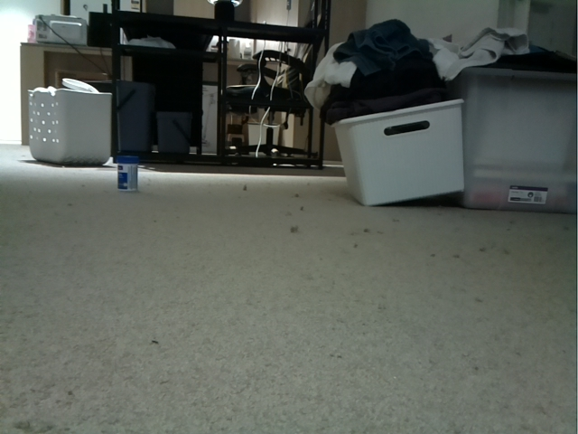
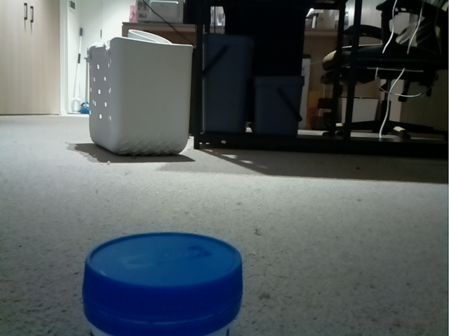
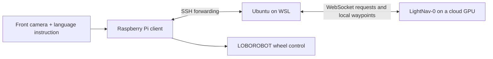

# Raspberry Pi 4 Robot Car

**A four-wheel rover that follows language instructions using a live camera feed and LightNav-0.**

[Real-robot demo](#real-robot-demo) · [How it works](#how-it-works) · [Run it](#run-it) · [Experiment history](#experiment-history)

## Real-robot demo

The rover received the instruction **“Find the small jar with the blue lid. Approach it and stop in front of it.”** LightNav-0 used the front camera to generate local waypoints. The Pi converted those waypoints into wheel commands, and the model issued a stop on prediction 14.

| Start | Frame that triggered the model stop |
| :---: | :---: |
|  |  |

The images show the rover approaching the jar. The final clearance was unmeasured. In a separate six-prediction run, the median cloud inference time was **342 ms** and the median Pi-to-cloud request round trip was **1.245 s**. [Development log and raw evidence](docs/development-logs/10-lightnav-vln.md)

## How it works

- **FPV driving.** A Raspberry Pi MJPEG feed and an Xbox controller support supervised teleoperation and pan/tilt control. [FPV experiment](experiments/09/Task09_FPV_Teleoperation_and_Xbox_Control.md)
- **Vision-language navigation.** The Pi sends camera frames to LightNav-0 and uses the returned waypoints, target visibility, and stop signal to control the rover. Recorded frames, model responses, and wheel commands share a sequence number. [VLN client](experiments/10-LightNav-VLN/task10_vln_pi.py)
- **Continuous capture.** The camera captures in the background while the rover executes the remaining part of a bounded motion command. The client sends the newest frame when inference is ready and shortens the motion budget for short approach waypoints. [Continuous capture notes](experiments/10-LightNav-VLN/README.md#连续采集与运动固定云台)

## Run it

| Mode | Start here |
| --- | --- |
| Drive manually with live video | [Task 09 setup and Xbox controls](experiments/09/Task09_FPV_Teleoperation_and_Xbox_Control.md) |
| Run LightNav-0 against the rover | [Task 10 cloud, Ubuntu, and Pi setup](experiments/10-LightNav-VLN/README.md) |
| Review a run without hardware | [Camera frames, JSONL logs, and latency measurements](docs/development-logs/10-lightnav-vln.md#实车运行记录) |

The documented setup puts inference on the GPU host and camera capture and actuation on the Pi. The laptop forwards traffic between them. The VLN client starts in observation mode and skips wheel movement until a driving mode is selected.

## Experiment history

| Stage | Work |
| --- | --- |
| Bring-up | [SSH and remote development](docs/development-logs/01-remote-connection.md) · [GPIO motor control](experiments/03-basic-robot-movement/03-basic-robot-movement.md) |
| Reactive autonomy | [Infrared avoidance](experiments/04-Infrared%20Obstacle%20Avoidance/04-Infrared-Obstacle-Avoidance.md) · [Ultrasonic avoidance](experiments/05-Ultrasonic-Obstacle-Avoidance/05-Ultrasonic-Obstacle-Avoidance.md) · [Predictive reactive navigation](experiments/08-Predictive%20Reactive%20Navigation/08-Predictive%20Reactive%20Navigation.md) |
| Camera and teleoperation | [FPV and Xbox control](experiments/09/Task09_FPV_Teleoperation_and_Xbox_Control.md) |
| Language-guided motion | [LightNav-0 on the physical rover](docs/development-logs/10-lightnav-vln.md) |

**Next experiment.** Start with the target outside the camera view and record an uninterrupted run from visual search to approach and model-triggered stop. The current records show these stages across separate runs. A second experiment will use two identical jars and vary only the left/right language instruction.

---

README layout inspiration from [Jeysom-feng’s GitHub profile showcase](https://github.com/Jeysom-feng/jeysom-github-io), based on the original design by [Zephyr Zhong](https://github.com/zyh3699).
