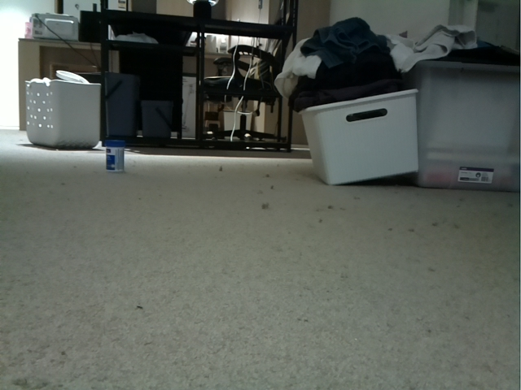
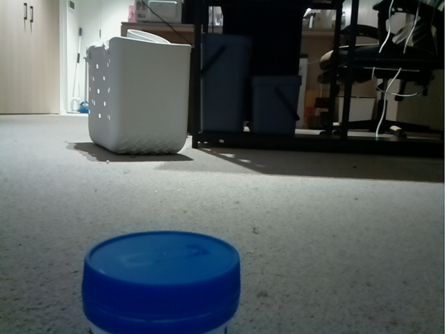

# Task 10 — LightNav-0 迁移到 Raspberry Pi 4 实车

- **记录日期** 2026-11-19（布里斯班）
- **平台** Raspberry Pi 4B、LOBOROBOT 四轮小车、PiCamera 云台、Windows 上的 Ubuntu 24.04（WSL2）、Vast.ai RTX 5090
- **阶段结论** 已复现给定语言目标后，实车根据 LightNav-0 的视觉路点靠近蓝盖药罐并由模型主动停车。从目标不入镜开始搜索的版本已观察到模型切入接近阶段，全流程到达尚未验证。

## 迁移目标和系统架构

此前的 MicroDuck 实验验证了云端 LightNav-0 可以用图像和语言生成轨迹，并通过 MPC 与步行策略驱动仿真机器人。本次沿用模型与 WebSocket 协议，将相机源和执行机构替换为树莓派小车上的真实相机和车轮。

```text
文字指令 + PiCamera JPEG → 树莓派 → 本机 Ubuntu SSH 转发 → 云端 LightNav-0
树莓派车轮 ← 本地路点转换 ← Ubuntu SSH 转发 ← 局部路点、visible、stop
```

Ubuntu 建立两条 SSH 隧道，分别连树莓派和云端。树莓派访问本机回环端口 8050，推理请求经 Ubuntu 转发。车端复用 FPV 实验的 PiCamera、云台归中和 LOBOROBOT 电机接口。既有电机驱动使用 PWM 30，车端用离散轮向和动作时间实现直行、弧线或原地转向。纯视觉实跑由 LightNav-0 的响应决定路线和停车，日志记录的是已下发的电机命令。 [客户端](../../experiments/10-LightNav-VLN/task10_vln_pi.py) · [部署说明](../../experiments/10-LightNav-VLN/README.md) · [LightNav-0 协议](https://github.com/lightorigins/LightNav-0/blob/main/docs/PROTOCOL.md)

## 实车运行记录

| 运行 | 初始条件和结果 | 证据 |
| --- | --- | --- |
| `blue-jar-01` | 药罐在正前方。模型 6 次均报告目标可见，树莓派下发 5 次直行，第 6 次模型主动要求停车。第 5 帧药罐已经接近画面下沿，第 6 帧药罐出画。实际停车间距和是否接触药罐无法从画面确认。 | [原始日志](assets/10-lightnav-vln/blue-jar-01.jsonl) |
| `blue-jar-search-01` | 目标起初不入镜。37 次推理均报告目标不可见，主要指令是左转，整轮到 60 秒上限结束。抽查帧发现转动中取景造成明显拖影。 | [原始日志](assets/10-lightnav-vln/blue-jar-search-01.jsonl) · [转动中画面](assets/10-lightnav-vln/search-motion-blur.jpg) |
| `blue-jar-search-02` | 改用动作结束后停稳取帧。第 20、21 次推理报告目标可见并给出直行路点，第 22 次再次报告不可见，最终达到 60 秒上限。 | 运行终端输出。完整帧和事件仍在树莓派的 `~/lightnav-pi/demos/blue-jar-search-02`，尚未核对模型指向的是哪个物体。 |
| `blue-jar-smooth-01` | 蓝盖药罐起始即在画面左侧。14 次推理中下发 9 次非零轮命令。第 12 次模型在目标不可见时给出停车，搜索模式继续取景；第 14 次模型同时返回目标可见和主动停车，车端结束运行。画面显示药罐已在车头近处。 | [原始日志](assets/10-lightnav-vln/blue-jar-smooth-01.jsonl) · [初始帧](assets/10-lightnav-vln/smooth-start.jpg) · [触发停车的帧](assets/10-lightnav-vln/smooth-model-stop.jpg) |

平滑模式运行中，首帧与触发停车的帧如下。右图是模型作出停车决策时看到的画面，车身到药罐的实际间距没有测量。

| 起始画面 | 触发停车的画面 |
| --- | --- |
|  |  |

## 延迟与运动连续性

| 运行 | 推理次数 | 云端推理中位数 | 车端请求往返中位数 |
| --- | ---: | ---: | ---: |
| 正前方目标 | 6 | 342.1 ms | 1.245 s |
| 转动中搜索 | 37 | 410.3 ms | 1.321 s |
| 平滑模式 | 14 | 637.4 ms | 1.699 s |

统计使用附件中每轮非预热的预测响应。云端数值来自服务端的 `latency_ms`。往返使用树莓派记录的 `round_trip_s`，覆盖本地请求处理、传输和云端预测。相机配置为 15 fps，日志中的往返时间衡量导航决策更新速度。

早期车端在每一轮推理后执行约 120 ms 的电机动作，停顿明显。纯视觉模式随后允许在等下一次推理时继续执行上一条指令，但正前方目标实验中模型将前进路点从约 15 cm 缩至约 5 cm 后，小车仍以相同 PWM 运行，暴露了最后一段行程控制的问题。

平滑模式将相机采集移到后台，只向推理请求提供最新帧。对于较长的直行，控制器参考前几个方向一致的累计路点，并从新路点中扣除推理期间估算已行驶的距离；较短的前进路点只使用第一点。平滑实跑中，长段动作预算约 1.61 s，仍经常在下一条决策到达前耗尽。另有 4 次更新计算出的剩余行程过短，车端下发零轮命令。因此该版本证实了取帧与控车能并行，尚未达到连续无停顿的车身运动。默认速度 0.28 m/s 是开环估算值，未在当前地面标定，云台也一直保持居中。

## VLN 证据与待验证结论

实车纯视觉运行保存了输入 JPEG、自然语言指令、云端原始响应和车端下发的轮命令。按 `seq` 对齐这些数据，可以验证小车根据 LightNav-0 的路点接近目标，并在模型主动返回 `stop=true` 时停车。调试期间曾单独尝试用 Python 跟踪蓝盖，该实验独立于上述 VLN 记录。

截至本次记录，已验证的是**实车视觉语言导航链路、目标接近和模型主动停车**。从画外完整搜到目标、准确停在目标前且没有接触目标、同场景下按不同语言指令选择不同物体，均未完成验证。录制对照视频时可保持同一场景和起始姿态，摆放两个外观相同的蓝盖罐，仅更换“去左边”与“去右边”的指令，同时记录实际轨迹与停止原因。本轮暂停新增实车实验。
